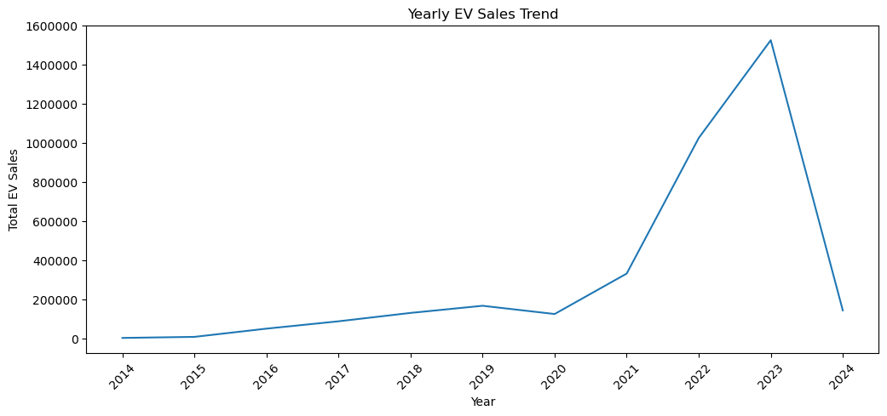
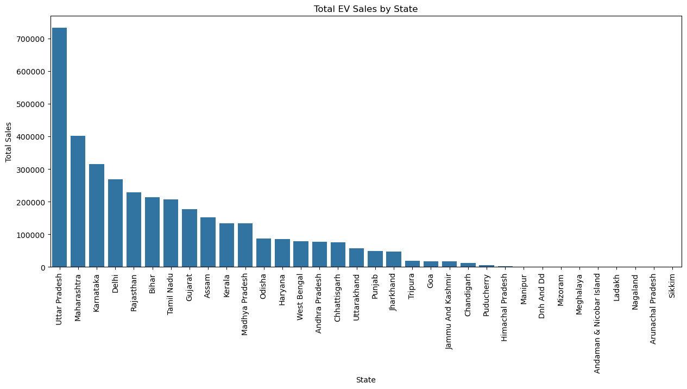
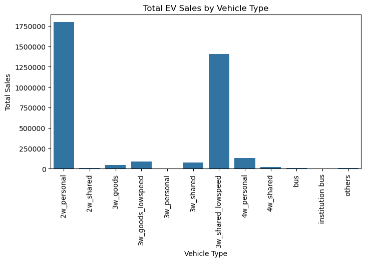
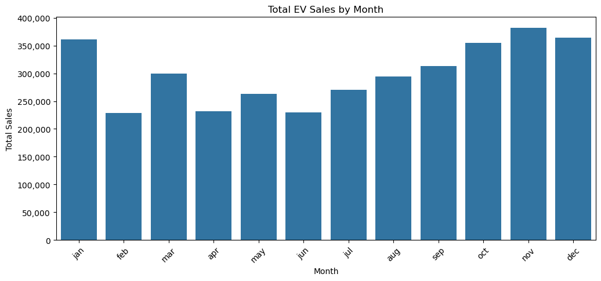
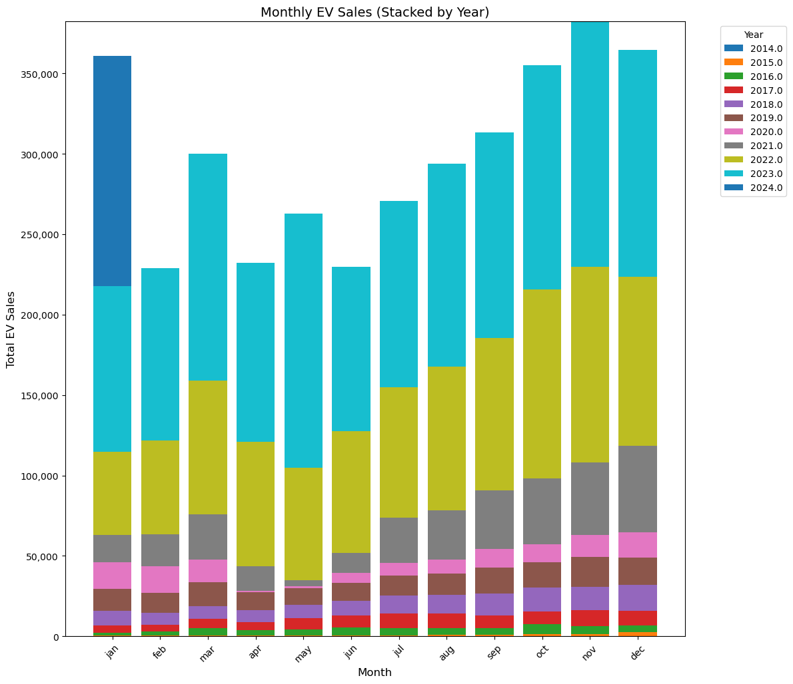

# Electric Vehicle Sales by State in India

An exploratory analysis of reported electric-vehicle sales across Indian states and vehicle segments, with a notebook-based comparison of regression models.

The project follows the data from initial inspection and cleaning through visual exploration, feature engineering, and model evaluation. It is an analytical project—not a live dashboard or production forecasting system.

## What the analysis covers

The [`ev_sales.ipynb`](./ev_sales.ipynb) notebook:

- inspects the CSV and standardizes selected fields, removes missing and duplicate rows, and parses dates;
- explores sales over time, by state, by vehicle type and class, and by month;
- engineers calendar, rolling-sales, growth, and categorical features;
- trains and compares Linear Regression, Random Forest, and XGBoost regressors using an 80/20 random train/test split.

## Visualizations

These charts are exported from the corresponding plotting cells in [`ev_sales.ipynb`](./ev_sales.ipynb).

<table>
  <tr>
    <td align="center"><strong>Yearly EV sales trend</strong><br></td>
    <td align="center"><strong>Total EV sales by state</strong><br></td>
  </tr>
  <tr>
    <td align="center"><strong>Total EV sales by vehicle type</strong><br></td>
    <td align="center"><strong>Total EV sales by month</strong><br></td>
  </tr>
  <tr>
    <td align="center"><strong>Monthly EV sales, stacked by year</strong><br></td>
    <td></td>
  </tr>
</table>

The 2024 total is much lower than 2023 in the supplied data and may represent a partial year; the repository does not include coverage metadata to confirm this.

### Findings from the supplied data

- **2-wheelers:** 1,808,105 reported sales (**50.3%** of the total).
- **3-wheelers:** 1,620,310 (**45.1%**). Together, these two categories account for approximately **95.4%**.
- **Largest state/territory totals:** Uttar Pradesh (732,074), Maharashtra (401,535), and Karnataka (315,498).
- **Annual total:** 2,392 in 2014 and 1,525,179 in 2023.

These are descriptive totals calculated from the CSV. They do not establish why sales changed or independently verify the underlying reporting.

### Model comparison

The notebook's saved evaluation results are:

| Model | R² | MAE | RMSE |
| --- | ---: | ---: | ---: |
| Linear Regression | 0.3880 | 12.08 | 97.57 |
| Random Forest | 0.9551 | 1.12 | 26.42 |
| XGBoost | 0.9854 | 1.20 | 15.09 |

MAE and RMSE are measured in sales-quantity units. XGBoost has the lowest recorded RMSE; Random Forest has the lowest recorded MAE. These scores describe the notebook's experiment, not guaranteed performance on future data.

## Data

The analysis reads [`Electric Vehicle Sales by State in India.csv`](./Electric%20Vehicle%20Sales%20by%20State%20in%20India.csv). The supplied file has 96,845 rows, eight columns, 34 distinct state/territory labels, and 3,593,811 total reported sales.

| Field | Meaning |
| --- | --- |
| `Year` | Reporting year |
| `Month_Name` | Reporting month |
| `Date` | Date field supplied with the record |
| `State` | State or territory label |
| `Vehicle_Class` | Detailed vehicle class |
| `Vehicle_Category` | Broader vehicle category |
| `Vehicle_Type` | Vehicle type |
| `EV_Sales_Quantity` | Reported sales quantity |

The repository does not identify the dataset's publisher, source URL, or collection methodology. Results should therefore be understood as an analysis of the included file, not as an independently validated measure of registrations or market share.

## Run the notebook

Use Python with `pip`, then install the libraries used in the notebook. From the repository root:

```powershell
py -m venv .venv
.\.venv\Scripts\Activate.ps1
python -m pip install jupyter pandas numpy matplotlib seaborn scikit-learn xgboost
jupyter lab
```

Open `ev_sales.ipynb` and run the cells from top to bottom. The notebook reads the CSV using a relative path, so start Jupyter from the repository root.

**Libraries:** pandas, NumPy, Matplotlib, Seaborn, scikit-learn, and XGBoost.

## Important limitations

The model results should be treated as preliminary. The notebook's three-row rolling mean includes the current row's sales target, allowing target information into the predictors. Its `shift(12)` growth calculation operates on row-level records and does not reliably match the same state and vehicle segment to the same month in the prior year. The random train/test split also does not measure performance on a later, unseen time period. Finally, date parsing does not specify a source format or day/month convention; parsed dates should be checked against `Year` and `Month_Name` before date-derived features are relied on.

A stronger forecasting experiment would first define a consistent state/vehicle-segment/month grain, build lagged features from past observations only, verify date interpretation, and evaluate with a chronological split.

## Project files

```text
.
├── ev_sales.ipynb
├── Electric Vehicle Sales by State in India.csv
├── visualizations/
│   ├── yearly-ev-sales.png
│   ├── ev-sales-by-state.png
│   ├── ev-sales-by-vehicle-type.png
│   ├── ev-sales-by-month.png
│   └── monthly-ev-sales-stacked-by-year.png
└── README.md
```

## Ideas for further work

- Correct leakage and align previous-year comparisons at a consistent data grain.
- Compare against simple baselines and evaluate errors by state, segment, and time period.
- Document the dataset's source, update cadence, and treatment of partial periods.
- Refresh the exported visualizations whenever the notebook code or input data changes, and add pinned dependency versions for reproducibility.
